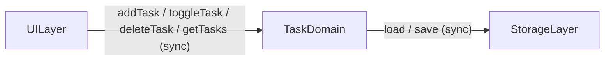

# Domain Design — Component Catalogue

## Sources

- [requirements](../requirements-analysis/requirements.md)
- [stories](../user-stories/stories.md)
- [team-practices](../practices-discovery/team-practices.md)

---

## Part A — Machine-Readable Catalogue

```yaml
components:
  - name: UILayer
    summary: Renders the task list and handles all DOM events; translates user actions into calls on TaskDomain.
    behaviour: >
      Reads the current task array from TaskDomain on every state change and
      re-renders the full task list. Handles the form submit event (add task),
      checkbox change events (toggle complete), and delete button click events.
      Passes raw user input to TaskDomain without pre-validation. Responds to
      TaskDomain results by triggering a re-render. Manages focus after task
      deletion (moves focus to next task item or back to the input field when
      list becomes empty). Applies completed-task styling (strikethrough +
      opacity) based on the task's completed flag.
    responsibilities:
      - Render the full page structure (header, form, task list, empty state)
      - Attach and manage DOM event listeners
      - Translate DOM events into TaskDomain method calls
      - Re-render the task list after every state change
      - Manage keyboard focus after task deletion
    depends_on:
      - component: TaskDomain
        interaction: Calls addTask, toggleTask, deleteTask, and getTasks to drive all state changes and reads
        style: sync
    dependents: []
    external_dependencies: []
    entities: []

  - name: TaskDomain
    summary: Owns the in-memory task array and enforces all business rules for creating, toggling, and deleting tasks.
    behaviour: >
      Maintains the authoritative in-memory task array. Validates that new task
      text is non-empty after trimming (FR1.6); silently ignores empty-input
      calls. Generates a unique id (UUID or timestamp-based) and a createdAt
      ISO-8601 timestamp for each new task. Tasks are stored in insertion order
      (oldest first, per FR1.2 / Q3 from user-stories stage). Delegates
      persistence to StorageLayer after every mutation (add, toggle, delete).
      Loads the initial task array from StorageLayer on app startup. Never
      interacts with the DOM.
    responsibilities:
      - Maintain the in-memory task array as the single source of truth
      - Validate inputs (non-empty text after trim)
      - Generate unique task identifiers and creation timestamps
      - Enforce insertion-order sort (oldest first)
      - Delegate persistence reads and writes to StorageLayer
    depends_on:
      - component: StorageLayer
        interaction: Calls load on startup to hydrate state; calls save after every mutation
        style: sync
    dependents:
      - component: UILayer
        interaction: UILayer calls addTask, toggleTask, deleteTask, and getTasks
    external_dependencies: []
    entities:
      - name: Task
        identifier: id
        attributes: [id, text, completed, createdAt]
        references: []

  - name: StorageLayer
    summary: Abstracts persistence behind a simple load/save interface; transparently uses localStorage or an in-memory fallback.
    behaviour: >
      On initialisation, detects whether localStorage is available by attempting
      a test write inside a try/catch. If available, all subsequent load and save
      calls use localStorage under the key "tasks". If unavailable (private
      browsing, quota exceeded, or any SecurityError), falls back to an
      in-memory array for the session — callers see no difference (FR3.3).
      Serialises the task array to JSON on save and deserialises on load.
      Never contains business logic; never validates task content.
    responsibilities:
      - Detect localStorage availability at initialisation
      - Serialise and persist the task array to localStorage
      - Deserialise and return the task array from localStorage on load
      - Provide a transparent in-memory fallback when localStorage is unavailable
    depends_on: []
    dependents:
      - component: TaskDomain
        interaction: TaskDomain calls load on startup and save after every mutation
    external_dependencies:
      - name: localStorage
        kind: other
        purpose: Browser-native key-value store used to persist the task array across sessions (FR3.1–FR3.4)
    entities: []
```

---

## Part B — Human-Readable View

### Component Diagram



<!-- Text fallback: Three components in a left-to-right chain. UILayer calls TaskDomain (sync). TaskDomain calls StorageLayer (sync). StorageLayer uses the browser's localStorage. No reverse or cross dependencies. -->

### Component Summary

| Component | Purpose | Depends On | Dependents | Entities Owned |
|---|---|---|---|---|
| UILayer | Renders DOM, handles events, drives re-render | TaskDomain | — | — |
| TaskDomain | Owns task array; enforces business rules; delegates persistence | StorageLayer | UILayer | Task |
| StorageLayer | Abstracts localStorage with in-memory fallback | — | TaskDomain | — |

### Entity Ownership

| Entity | Owning Component | Identifier | Attributes | References |
|---|---|---|---|---|
| Task | TaskDomain | id | id, text, completed, createdAt | — |

### External Dependencies

| Component | Dependency | Kind | Purpose |
|---|---|---|---|
| StorageLayer | localStorage | other | Persist task array across browser sessions |

### Rationale

| Component | Reason for Separate Building Block |
|---|---|
| UILayer | Distinct concern (presentation and event handling); its change rate is driven by visual design decisions; contains zero business logic |
| TaskDomain | Distinct concern (business rules, data integrity, state); owns the only domain entity (Task); validation and mutation logic changes for domain reasons, not UI reasons |
| StorageLayer | Distinct concern (persistence strategy); its change rate is driven by storage technology decisions; the fallback logic is an infrastructure concern that should not leak into business logic |

**Alternatives rejected:** A two-component split (UI + Storage) was viable but would have placed validation and state management in the UI layer, coupling business rules to DOM code. A one-component design was considered for simplicity but rejected because it makes the validation and persistence logic untestable in isolation. See ADR-001.

---

## Assumptions & Open Questions

- [assumption] The three-component decomposition maps directly to three JavaScript modules (files): `ui.js`, `tasks.js`, `storage.js`. The exact file structure is decided in Code Generation. [Q1: C]
- [assumption] Component interaction is synchronous function calls — no event bus or pub/sub needed for a single-page app of this size. [Q1: C]
- [assumption] `id` generation uses `Date.now().toString()` or `crypto.randomUUID()` (whichever is available); uniqueness is sufficient for a single-user local app. [requirements FR2.1]
